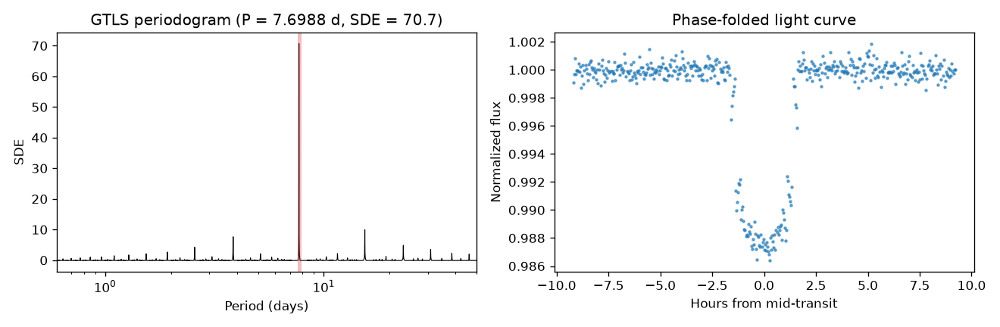

# GTLS: GPU Transit Least Squares

[](https://pypi.org/project/gputls/)
[](LICENSE)

GTLS is a CUDA implementation of the [Transit Least Squares (TLS)](https://github.com/hippke/tls)
algorithm for detecting periodic exoplanet transits in light curves. It keeps the TLS
interface and transit model, and evaluates all trial periods, durations and epochs
in parallel on an NVIDIA GPU, which makes it several times faster than CPU TLS.



## Features

- Drop-in replacement for the `transitleastsquares` search API
- Limb-darkened transit templates (default, grazing and box-shaped)
- Batches trial periods automatically to fit the free GPU memory
- Refines the strongest peaks and their period aliases (P/2, 2P, 2P/3, 3P/2) with a full search at every cadence
- Supports multi-GPU machines (`GPUDeviceID`)

## Requirements

- An NVIDIA GPU with CUDA
- Python >= 3.8
- [CuPy](https://cupy.dev/) matching your CUDA version

## Installation

CuPy wheels depend on the local CUDA version, so CuPy is not a hard dependency.
Install CuPy following the [official guide](https://docs.cupy.dev/en/stable/install.html),
then install GTLS:

```bash
pip install gputls
```

Or let pip pick a CuPy build for you:

```bash
pip install "gputls[cuda12]"   # CUDA 12.x
pip install "gputls[cuda11]"   # CUDA 11.x
```

To install from source:

```bash
git clone https://github.com/Farthing-0/GTLS.git
cd GTLS
pip install .
```

## Quick start

```python
from gputls import gtls

# time in days, flux normalized to 1, optional flux uncertainties dy
model = gtls(time, flux, dy)
result = model.power()

print(result.period, result.T0, result.duration, result.depth, result.SDE)
```

`power()` accepts the same keyword arguments as TLS. Commonly used ones:

| Argument | Default | Description |
| --- | --- | --- |
| `period_min`, `period_max` | `0`, `inf` | Limits of the automatic period grid (days) |
| `periods` | `[]` | Custom array of trial periods; overrides the automatic grid |
| `R_star`, `M_star` | `1.0`, `1.0` | Stellar radius and mass (solar units) used for the period grid |
| `oversampling_factor` | `3` | Period grid oversampling |
| `duration_grid_step` | `1.1` | Multiplicative step of the duration grid |
| `transit_depth_min` | `1e-5` | Minimum depth of a trial transit |
| `transit_template` | `"default"` | `"default"`, `"grazing"` or `"box"` |
| `T0_fit_margin` | `0.125` | Epoch step of the coarse search as a fraction of the duration (0 to 0.125; 0 tests every cadence) |
| `GPUDeviceID` | `0` | CUDA device to run on |
| `bar_location` | `0` | Position of the progress bar, useful when running several searches in parallel |
| `fast` | `False` | Return only `(periods, power)`, skipping the refinement and transit statistics |

### Results

`power()` returns a `gtlsResult` object with the following attributes:

| Attribute | Description |
| --- | --- |
| `period` | Best period (days) |
| `T0` | Mid-transit time of the first transit (days) |
| `duration` | Transit duration (days) |
| `depth` | Fractional transit depth (`1 - in-transit flux`). Note: TLS reports the in-transit flux level instead |
| `SDE` | Signal Detection Efficiency of the best period |
| `snr`, `snrPink` | Signal-to-noise ratio with white and pink (correlated) noise |
| `snrFit`, `snrFitPink` | Signal-to-noise ratio from the fitted transit depth |
| `transitTimes` | Mid-transit times within the light curve |
| `periods`, `power` | Periodogram: trial periods and SDE power |
| `chi2` | Minimum chi² of each period after refinement |
| `raw_chi2`, `raw_power` | Minimum chi² and power of the coarse search, before refinement |
| `possiblePeriods`, `possiblePeriodsIndices` | Periods that were refined, and their indices in `periods` |
| `rawDuration`, `rawDurations`, `durationPoints` | Best duration as a fraction of the period, the duration grid, and the best duration in data points |

## Examples

The [`examples/`](examples/) folder contains Jupyter notebooks comparing GTLS with TLS:

- [`tess_tutorial.ipynb`](examples/tess_tutorial.ipynb): a TESS target
- [`kepler_tutorial.ipynb`](examples/kepler_tutorial.ipynb): a Kepler target downloaded with `lightkurve`

The notebooks also need `matplotlib`, `astropy`, `transitleastsquares`, `lightkurve` and `wotan`.

## Testing

The test suite runs end-to-end searches on the GPU: injection-recovery on a synthetic
light curve, the `fast` mode, and a real Kepler light curve stored in
[`tests/data/`](tests/data/). It needs `astropy` in addition to the runtime dependencies.

One-click build, install and test (inside an environment where CuPy is installed):

```bash
./run_tests.sh            # GPU 0
./run_tests.sh 1          # GPU 1
PYTHON=/path/to/python ./run_tests.sh
```

The script reinstalls only `gputls` itself (`--no-deps`) and then runs
`tests/test_gtls.py`. The tests can also be run with `pytest tests`; select the GPU with
the `GTLS_GPU_DEVICE` environment variable.

## Project structure

```
GTLS/
├── src/gputls/          # Python package
│   ├── main.py          # gtls class (public API)
│   ├── core.py          # GPU search driver
│   ├── kernels.cu       # CUDA kernels, compiled at runtime by CuPy
│   ├── grid.py          # period and duration grids
│   ├── transit.py       # transit templates (batman)
│   ├── stats.py         # periodogram and SNR statistics
│   ├── validate.py      # input and argument validation
│   ├── constants.py     # default parameters
│   └── ...
├── tests/               # GPU test suite and test data
├── examples/            # Jupyter notebooks
├── docs/images/         # Figures used in the documentation
├── run_tests.sh         # One-click build and test
└── pyproject.toml
```

## Acknowledgements and license

GTLS is adapted from [TLS](https://github.com/hippke/tls) by Michael Hippke and René Heller.
If you use GTLS, please also cite the TLS paper:
Hippke, M. & Heller, R. (2019), *Optimized transit detection algorithm to search for periodic transits of small planets*,
[A&A 623, A39](https://doi.org/10.1051/0004-6361/201834672).

Both TLS and GTLS are released under the [MIT License](LICENSE).
