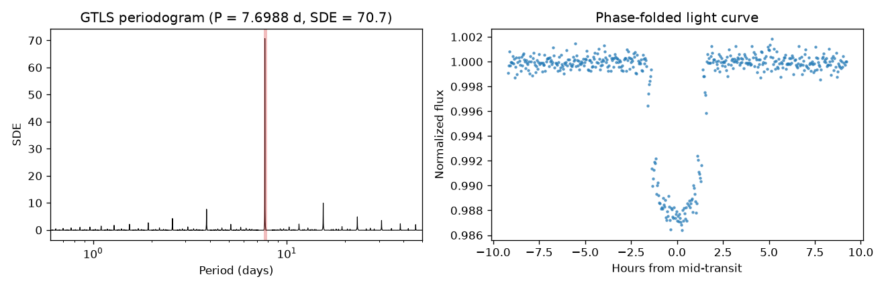

# GTLS: GPU Transit Least Squares

[](https://pypi.org/project/gputls/)
[](https://github.com/Farthing-0/GTLS/blob/main/LICENSE)

GTLS is a CUDA implementation of the [Transit Least Squares (TLS)](https://github.com/hippke/tls)
algorithm for detecting periodic exoplanet transits in light curves. It keeps the TLS
interface and transit model, and evaluates all trial periods, durations and epochs
in parallel on an NVIDIA GPU, which makes it several times faster than CPU TLS.



## Features

Version 2.2.5 adds online selection of screening cascade lengths with
`screening_policy="auto"`, and fuses four-level screening on larger workloads
with early termination of fully pruned candidate blocks. Conservative bounds,
exact candidate evaluation, and tie ordering are preserved. Sliding-window
noise statistics use the GPU on supported inputs. The TLS-compatible `snr` and
`snrPink` fields remain; `snrFit` and `snrFitPink` have been removed.

Version 2.2.4 aligns the final candidate's epoch fit and duration conversion
with TLS2 2.0.4. The reported transit times and noise statistics now use those
windows. This adds one CPU epoch fit after the GPU search; periodograms and
the default 0.01 epoch-search margins are unchanged. Native template/depth
selection remains on the GPU, so this does not promise bitwise equality of
every output with TLS2.

Version 2.2.3 corrects the out-of-transit noise masks used by `snr` and
`snrPink`: their duration is now expressed in days, matching the time array.
Earlier versions passed a fractional duration, which could bias the reported
signal-to-noise ratios. Period searches, periodograms, and the default 0.01
epoch-search margins are unchanged by this correction.

- Drop-in replacement for the `transitleastsquares` search API
- Limb-darkened transit templates (default, grazing and box-shaped)
- Batches trial periods automatically to fit the free GPU memory
- Refines the strongest peaks and their period aliases (P/2, 2P, 2P/3, 3P/2) with a finer epoch search, and fits the best period at every cadence
- Supports multi-GPU machines: pick a device with `GPUDeviceID` or split one search across several with `GPUDeviceIDs`

## Requirements

- An NVIDIA GPU with CUDA
- Python >= 3.8
- [CuPy](https://cupy.dev/) matching your CUDA version

## Installation

CuPy wheels depend on the local CUDA version, so CuPy is not a hard dependency.
Install CuPy following the [official guide](https://docs.cupy.dev/en/stable/install.html),
then install GTLS:

```bash
pip install gputls
```

Or let pip pick a CuPy build for you:

```bash
pip install "gputls[cuda13]"   # CUDA 13.x, installs cupy-cuda13x[ctk]
pip install "gputls[cuda12]"   # CUDA 12.x, installs cupy-cuda12x[ctk]
pip install "gputls[cuda11]"   # CUDA 11.x, installs cupy-cuda11x (needs a local CUDA Toolkit)
```

GTLS compiles its CUDA kernels at runtime, so CuPy must be able to find the CUDA
headers, otherwise the search fails with `Failed to find CUDA headers`:

- CUDA 12 / 13: the `cuda12` / `cuda13` extras install the headers from pip through
  CuPy's `[ctk]` extra. If you install CuPy yourself, use `pip install "cupy-cuda12x[ctk]"`
  (or `cupy-cuda13x[ctk]`), or point `CUDA_PATH` to a local CUDA Toolkit.
- CUDA 11: `cupy-cuda11x` has no `[ctk]` extra (and stops at CuPy 13), so install the
  [CUDA Toolkit](https://developer.nvidia.com/cuda-toolkit-archive) and set `CUDA_PATH`
  if it is not in the default location (e.g. `export CUDA_PATH=/usr/local/cuda-11.8`).

To install from source:

```bash
git clone https://github.com/Farthing-0/GTLS.git
cd GTLS
pip install .
```

## Quick start

```python
from gputls import gtls

# time in days, flux normalized to 1, optional flux uncertainties dy
model = gtls(time, flux, dy)
result = model.power()

print(result.period, result.T0, result.duration, result.depth, result.SDE)
```

`power()` accepts the same keyword arguments as TLS. Commonly used ones:

| Argument | Default | Description |
| --- | --- | --- |
| `period_min`, `period_max` | `0`, `inf` | Limits of the automatic period grid (days) |
| `periods` | `[]` | Custom array of trial periods; overrides the automatic grid |
| `R_star`, `M_star` | `1.0`, `1.0` | Stellar radius and mass (solar units) used for the period grid |
| `R_star_min`, `R_star_max` | `0.13`, `3.5` | Stellar radius limits (solar units) of the plausible transit durations |
| `M_star_min`, `M_star_max` | `0.1`, `1.0` | Stellar mass limits (solar units) of the plausible transit durations. Paired with the radius limits as in TLS 2: (R_star_min, high mass) for the shortest and (R_star_max, low mass) for the longest duration |
| `oversampling_factor` | `3` | Period grid oversampling |
| `duration_grid_step` | `1.1` | Multiplicative step of the duration grid |
| `transit_depth_min` | `1e-5` | Minimum depth of a trial transit |
| `transit_template` | `"default"` | `"default"`, `"grazing"` or `"box"` |
| `T0_fit_margin` | `0.01` | Epoch step of the coarse search as a fraction of the duration (0 to 0.125; 0 tests every cadence) |
| `T0_refine_margin` | `0.01` | Epoch step when the strongest peaks are re-searched, as a fraction of the duration (0 to 0.125; 0 tests every cadence). 0.01 is the T0 resolution of TLS |
| `screening_tolerances` | `None` | Optional strictly decreasing positive certificate tolerances. `None` uses `(0.05, 0.015, 0.005, 0.00025)`; `(0.05,)` uses one pass; `()` disables screening. Controls pruning cost, not the search grid or final statistic. The best schedule depends on the data and GPU |
| `screening_policy` | `"fixed"` | `"auto"` measures 1–4 leading levels of the standard cascade per period band and device, then reuses the chosen length. Cannot be combined with explicit `screening_tolerances`. Calibration is included in the search and may outweigh savings on short searches; `"fixed"` retains the behavior above |
| `GPUDeviceID` | `0` | CUDA device to run on |
| `GPUDeviceIDs` | `None` | List of CUDA devices to split the search across (e.g. `[0, 1]`); overrides `GPUDeviceID`. Results are identical to a single-GPU run |
| `bar_location` | `0` | Position of the progress bar, useful when running several searches in parallel |
| `fast` | `False` | Return only `(periods, power)`, skipping the refinement and transit statistics |

With `screening_policy="auto"`, `model.screening_diagnostics` records the choices
and calibration batches for that call. Each calibration batch is split into four
interleaved subsets covering a similar period range; every period is evaluated
once. The policy compares wall time per period and prefers fewer levels within
5% of the fastest measurement. Period bands span factors of 32 for fewer than
32,768 samples and factors of 8 for larger curves. Small batches (fewer than 16
periods) use one level without calibration; candidate refinement reuses a known
band or uses one level. Existing screening eligibility checks still apply.
`calibration_seconds` measures the entire calibration batches, including useful
search work, not just incremental overhead. It is already included in total
search time. Decisions are local to each search and device; no offline timing
table or previous curve's decisions are reused. Auto selects cascade prefixes,
not arbitrary new tolerance values, and does not guarantee the fastest policy.

For four-level screening, curves with at least 32,768 samples and batches with
at least 128 periods use one fused GPU cascade. Candidate blocks stop refining
once every candidate is strictly worse than a certified upper bound. The bounds,
final exact evaluation, and tie ordering are unchanged. Smaller workloads retain
separate kernels to avoid the extra register cost of fusion. These thresholds
control execution cost, not the candidate acceptance criteria.

### Results

`power()` returns a `gtlsResult` object with the following attributes:

| Attribute | Description |
| --- | --- |
| `period` | Best period (days) |
| `T0` | Mid-transit time of the first transit (days) |
| `duration` | Transit duration (days) |
| `depth` | Fractional transit depth (`1 - in-transit flux`). Note: TLS reports the in-transit flux level instead |
| `SDE` | Signal Detection Efficiency of the best period |
| `snr`, `snrPink` | Signal-to-noise ratio with white and pink (correlated) noise |
| `transitTimes` | Mid-transit times within the light curve |
| `periods`, `power` | Periodogram: trial periods and SDE power |
| `chi2` | Minimum chi² of each period after refinement |
| `raw_chi2`, `raw_power` | Minimum chi² and power of the coarse search, before refinement |
| `possiblePeriods`, `possiblePeriodsIndices` | Periods that were refined, and their indices in `periods` |
| `rawDuration`, `rawDurations`, `durationPoints` | Best duration as a fraction of the period, the duration grid, and the best duration in data points |

`snrPink` uses GPU window standard deviations for finite `float64` inputs with
at least 4096 windows and window widths up to 1024 points. Wider windows and
other unsupported inputs retain the CPU path. The GPU reduction preserves
NumPy's summation order, including the final CPU chunk reductions.

## Examples

The [`examples/`](https://github.com/Farthing-0/GTLS/tree/main/examples) folder contains Jupyter notebooks comparing GTLS with TLS:

- [`tess_tutorial.ipynb`](https://github.com/Farthing-0/GTLS/blob/main/examples/tess_tutorial.ipynb): a TESS target
- [`kepler_tutorial.ipynb`](https://github.com/Farthing-0/GTLS/blob/main/examples/kepler_tutorial.ipynb): a Kepler target downloaded with `lightkurve`

The notebooks also need `matplotlib`, `astropy`, `transitleastsquares`, `lightkurve` and `wotan`.

## Testing

The test suite runs end-to-end searches on the GPU: injection-recovery on a synthetic
light curve, the `fast` mode, a real Kepler light curve stored in
[`tests/data/`](https://github.com/Farthing-0/GTLS/tree/main/tests/data), release of GPU memory after a search, and (on machines with
at least two GPUs) bitwise agreement between single- and multi-GPU searches. It needs `astropy` in addition to the runtime dependencies.

One-click build, install and test (inside an environment where CuPy is installed):

```bash
./run_tests.sh            # GPU 0
./run_tests.sh 1          # GPU 1
PYTHON=/path/to/python ./run_tests.sh
```

The script reinstalls only `gputls` itself (`--no-deps`) and then runs
`tests/test_gtls.py`. The tests can also be run with `pytest tests`; select the GPU with
the `GTLS_GPU_DEVICE` environment variable.

### Comparison with TLS 1.x and TLS 2.x

[`tests/tls_compare/`](https://github.com/Farthing-0/GTLS/tree/main/tests/tls_compare) benchmarks GTLS against the last TLS 1.x
release (1.32) and TLS 2.x (2.0.4). All engines search the same mock Kepler and
TESS-SPOC pipeline products, which are read and detrended with `lightkurve`. The
benchmark reports runtimes, recovery of the injected transits and cross-engine agreement.
Both TLS versions are installed automatically into isolated directories. The benchmark
needs `lightkurve` (`pip install "gputls[test]"`):

```bash
python tests/compare_tls.py                  # standard suite: report.md + report.json
python tests/compare_tls.py --suite full --plot
python tests/compare_tls.py --suite long --timeout 3600 --repeat-limit 60   # whole Kepler mission, short cadence
pytest tests/test_tls_compare.py             # injection recovery and agreement checks
```

## Project structure

```
GTLS/
├── src/gputls/          # Python package
│   ├── main.py          # gtls class (public API)
│   ├── core.py          # GPU search driver
│   ├── kernels.cu       # CUDA kernels, compiled at runtime by CuPy
│   ├── grid.py          # period and duration grids
│   ├── transit.py       # transit templates (batman)
│   ├── stats.py         # periodogram and SNR statistics
│   ├── validate.py      # input and argument validation
│   ├── constants.py     # default parameters
│   └── ...
├── tests/               # GPU test suite, TLS comparison framework (tls_compare/) and test data
├── examples/            # Jupyter notebooks
├── docs/images/         # Figures used in the documentation
├── run_tests.sh         # One-click build and test
└── pyproject.toml
```

## Acknowledgements and license

GTLS is adapted from [TLS](https://github.com/hippke/tls) by Michael Hippke and René Heller.
If you use GTLS, please also cite the TLS paper:
Hippke, M. & Heller, R. (2019), *Optimized transit detection algorithm to search for periodic transits of small planets*,
[A&A 623, A39](https://doi.org/10.1051/0004-6361/201834672).

Both TLS and GTLS are released under the [MIT License](https://github.com/Farthing-0/GTLS/blob/main/LICENSE).
